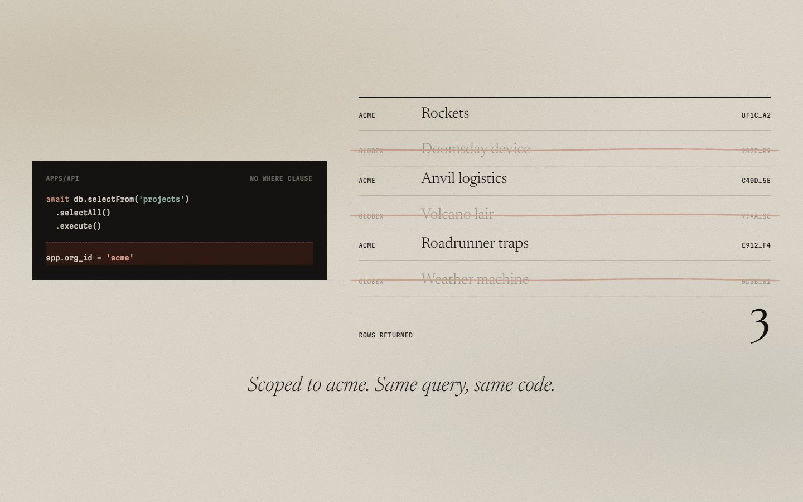
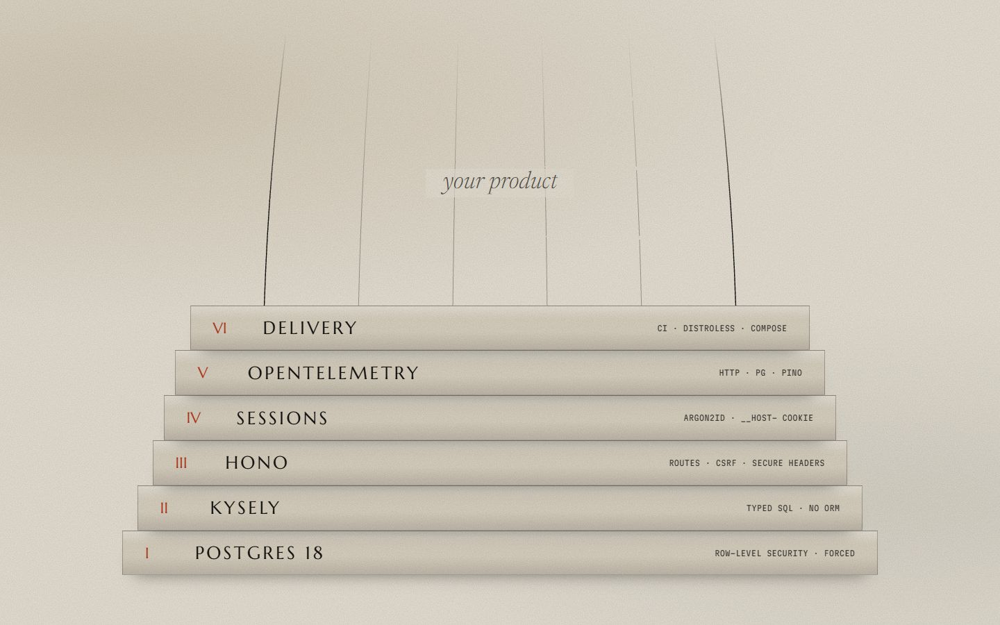

# Plinth

The ground floor of a multi-tenant product: the part you lay before the
first feature and never want to revisit.

Its one strong opinion: **tenant isolation is enforced by Postgres, not by
remembering a `where org_id = ?`.** A handler that forgets to scope its query
gets zero rows back, not somebody else's.

[Showcase](https://toni-bobocel.github.io/plinth/) ·
[Decisions](docs/adr) ·
[Tenancy tests](apps/api/test/tenancy.test.ts)


## What's in it

|               |                                                                     |
| ------------- | ------------------------------------------------------------------- |
| `packages/db` | Schema, migrations, RLS policies, `withTenant` / `withUser`         |
| `apps/api`    | Hono service: cookie sessions, orgs, members, projects, audit log   |
| `apps/site`   | The showcase above: Astro, GSAP (SplitText, DrawSVG, ScrollTrigger) |
| `infra`       | Postgres role bootstrap for the compose stack                       |

Postgres 18, Kysely, Hono, Zod, argon2id, OpenTelemetry, pnpm workspaces,
Turborepo, Biome, Vitest, distroless image, GitHub Actions.

## Run it

```sh
docker compose up --build
curl localhost:8787/healthz
open http://localhost:16686        # Jaeger, traces for every request
```

Without Docker:

```sh
pnpm install
pnpm test                          # PGlite, no database to start
```

## How isolation works



1. Migrations run as the owner. The API connects as `plinth_app`, which owns
   nothing, so `FORCE ROW LEVEL SECURITY` always applies to it.
2. Each tenant-owned table has a policy on
   `org_id = current_setting('app.org_id')::uuid`.
3. `requireMembership` resolves `/orgs/:org` to a `TenantScope`, and handlers
   run their queries inside `withTenant(db, scope, fn)`, which sets the
   setting with transaction scope. Nothing survives into the next checkout of
   a pooled connection.
4. No scope, no rows. A cross-tenant insert is rejected by the policy's
   `with check`, and the audit trail is append-only at the grant level.

The tests make this concrete instead of asserting it in prose: an unfiltered
`select` that only sees one tenant, an insert into another org that Postgres
refuses, a `delete from audit_events` that fails on permissions. They run
against PGlite under the same restricted role, and CI repeats the migration
and an RLS smoke check on a real Postgres 18.

## Trade-offs I took on purpose

- **Shared tables over schema or database per tenant.** Cheapest to operate,
  and RLS recovers most of the isolation. A tenant that outgrows it can be
  moved out, since `org_id` already partitions every row. See
  [ADR 2](docs/adr/0002-tenancy-with-rls.md).
- **Every tenant query is a transaction.** That costs a `BEGIN`/`COMMIT` round
  trip, and it is the shape a transaction-mode pooler wants anyway.
- **Hand-maintained `DB` types.** Generating them needs a live database at
  build time; I'd add `kysely-codegen` with a diff check once the schema
  starts moving weekly.
- **No in-process rate limiting.** Counters per instance are wrong as soon as
  there are two. Login throttling belongs to the edge or to Redis.
- **Opaque sessions, not JWTs.** One indexed lookup per request buys instant
  revocation and nothing readable by page scripts. See
  [ADR 4](docs/adr/0004-opaque-session-cookies.md).

## At ten times the size

- Put PgBouncer in transaction mode in front of Postgres. The
  transaction-local settings are already compatible with it.
- Cache session lookups for a few seconds, keyed by the token hash.
- Split `audit_events` by month with native partitioning, and ship old
  partitions to object storage.
- Add an OpenTelemetry Collector between the service and the backend, for
  tail sampling: keep every error trace and 5 % of the rest.



## Layout

```
apps/
  api/        hono service, Dockerfile, integration tests
  site/       showcase (GitHub Pages)
packages/
  db/         kysely schema, migrations, tenant helpers
docs/adr/     architecture decision records
infra/        compose bootstrap
```

## License

MIT
